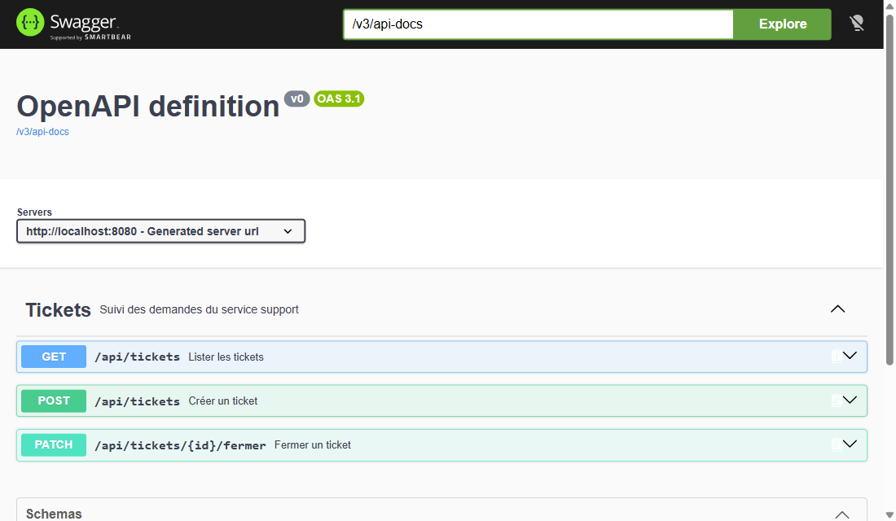
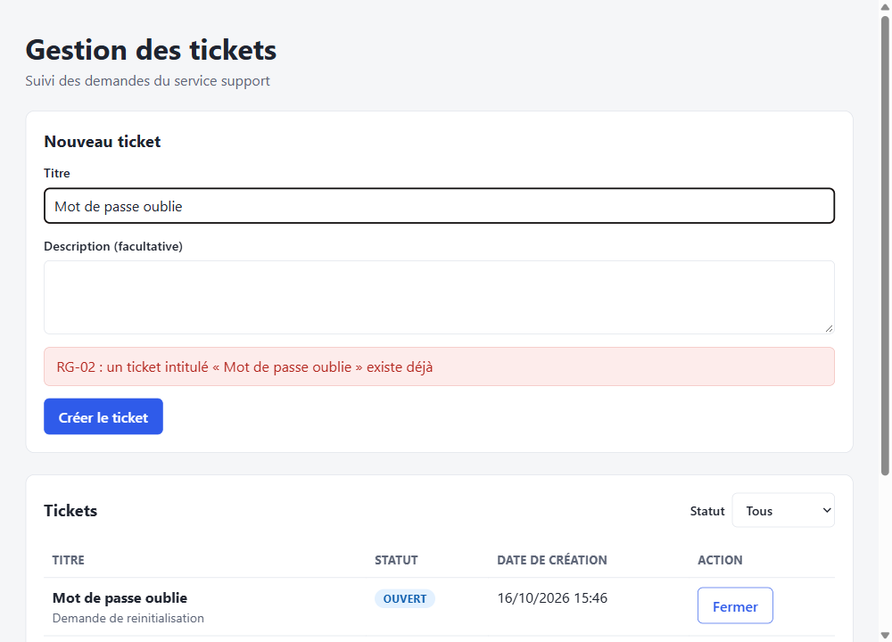

# Rattrapage : module Ticket

Rattrapage KFOKAM48, Batch 2, Phase 3 (séances Full Stack 1, 2 et 3).
Application de suivi des demandes d'un service support : on crée des tickets, on les liste (avec un filtre par statut) et on les ferme.

**Auteur** : Ngouanet Billy

## Technologies

| Couche | Technologie |
|---|---|
| Base de données | PostgreSQL 16 (dans Docker) |
| Backend | Spring Boot 4.1 (Java 21, Maven), Spring Data JPA, Bean Validation, springdoc (Swagger) |
| Frontend | React (Vite) |

## Prérequis

- Docker (Docker Desktop lancé)
- Java 21
- Node.js 20 ou plus

## Lancer le projet

À la racine du dépôt, dans trois terminaux.

**1. Base de données**

```bash
docker compose up -d
```

La base `tickets` est créée (utilisateur `tickets`, mot de passe `tickets`, port 5432).

**2. Backend** (http://localhost:8080)

```bash
cd backend
./mvnw spring-boot:run        # sous PowerShell : .\mvnw.cmd spring-boot:run
```

Swagger : http://localhost:8080/swagger-ui/index.html

**3. Frontend** (http://localhost:5173)

```bash
cd frontend
npm install
npm run dev
```

Par défaut, le frontend appelle `http://localhost:8080/api/tickets`. On peut changer l'adresse avec la variable `VITE_API_URL`.

## Le ticket

| Champ | Type | Contraintes |
|---|---|---|
| `id` | identifiant | généré |
| `titre` | texte | obligatoire, 100 caractères maximum, unique |
| `description` | texte | facultative |
| `statut` | `OUVERT`, `EN_COURS`, `FERME` | `OUVERT` à la création |
| `dateCreation` | date et heure | générée par le serveur, jamais fournie par le client |

### Règles de gestion

| Réf. | Règle |
|---|---|
| RG-01 | Le titre est obligatoire et ne dépasse pas 100 caractères. Un ticket est créé avec le statut `OUVERT`. |
| RG-02 | Deux tickets ne peuvent pas avoir le même titre (sans tenir compte de la casse). |
| RG-03 | Un ticket ne peut être fermé que s'il est `OUVERT` ou `EN_COURS`. Un ticket `FERME` ne change plus d'état. |

## API

| Verbe | Chemin | Rôle | Succès | Erreurs |
|---|---|---|---|---|
| `POST` | `/api/tickets` | Créer un ticket | 201 | 400, 409 |
| `GET` | `/api/tickets?statut=OUVERT` | Lister, filtrable par statut (le paramètre est facultatif) | 200 | 400 (statut inconnu) |
| `PATCH` | `/api/tickets/{id}/fermer` | Fermer un ticket | 200 | 404, 409 |

Le client n'envoie que `titre` et `description`.

Toutes les erreurs ont le même format :

```json
{
  "status": 409,
  "erreur": "Conflict",
  "message": "RG-02 : un ticket intitulé « Imprimante en panne » existe déjà",
  "horodatage": "2026-10-16T15:34:10.908"
}
```

- **400** : titre absent ou de plus de 100 caractères, corps illisible, statut inconnu. Le message dit pourquoi.
- **404** : identifiant inconnu.
- **409** : règle de gestion violée. Le message nomme la règle (RG-02 ou RG-03).

### Essai rapide

```bash
curl -X POST http://localhost:8080/api/tickets \
  -H "Content-Type: application/json" \
  -d '{"titre":"Impossible de me connecter","description":"Erreur 500 au login"}'

curl "http://localhost:8080/api/tickets?statut=OUVERT"

curl -X PATCH http://localhost:8080/api/tickets/1/fermer
```

### Retrouver un ticket en base

```bash
docker exec -it tickets-db psql -U tickets -d tickets -c "SELECT * FROM ticket;"
```

## Architecture

### Backend (`backend/src/main/java/com/kfokam/ticket`)

| Dossier | Rôle |
|---|---|
| `controller` | `TicketController` : reçoit les requêtes HTTP et délègue, sans logique métier. Documentation Swagger. |
| `service` | `TicketService` : règles de gestion RG-01, RG-02 et RG-03. |
| `repository` | `TicketRepository` : accès aux données (Spring Data JPA). |
| `model` | `Ticket` (entité) et `StatutTicket`. |
| `dto` | `TicketRequest` (entrée, avec la validation) et `TicketResponse` (sortie). L'entité ne sort jamais du service. |
| `exception` | Exceptions métier et `GestionnaireErreurs` (`@RestControllerAdvice`) qui les traduit en 400, 404 et 409. |
| `config` | `CorsConfig` : autorise le frontend (ports 5173 et 3000). |

### Frontend (`frontend/src`)

| Fichier | Rôle |
|---|---|
| `services/ticketService.js` | Seul endroit qui appelle l'API. Transforme les erreurs en messages lisibles. |
| `components/TicketsContainer.jsx` | Conteneur : porte l'état et fait les appels. |
| `components/TicketList.jsx` | Liste, filtre par statut et les états chargement, liste vide et erreur. |
| `components/TicketForm.jsx` | Formulaire de création. Le bouton reste inactif tant que le titre est vide. |
| `components/ConfirmationFermeture.jsx` | Confirmation avant la fermeture d'un ticket. |

### Gestion des états de l'écran

- **Chargement** : un indicateur est visible pendant l'appel.
- **Données** : le tableau (titre, statut, date de création, action).
- **Liste vide** : le message « Aucun ticket ».
- **Erreur** : un message compréhensible (par exemple « Le serveur est injoignable ») et un bouton « Réessayer ».
- **Refus du serveur** : les messages 400 et 409 s'affichent tels quels, à côté du formulaire ou au-dessus de la liste. Il n'y a ni `alert()` ni message générique.

## Captures

**Swagger : les trois endpoints**



**Refus 409 affiché dans l'écran**



## Dépannage

- **Le backend ne démarre pas** : vérifier que Docker tourne et que la base est prête (`docker compose ps`).
- **Port 5432 déjà utilisé** : arrêter l'autre base PostgreSQL, ou changer le port dans `docker-compose.yml` et dans `backend/src/main/resources/application.properties`.
- **L'écran affiche « Le serveur est injoignable »** : le backend n'est pas démarré. Le lancer puis cliquer sur « Réessayer ».
- **Tout remettre à zéro** : `docker compose down -v` supprime la base et ses données.
